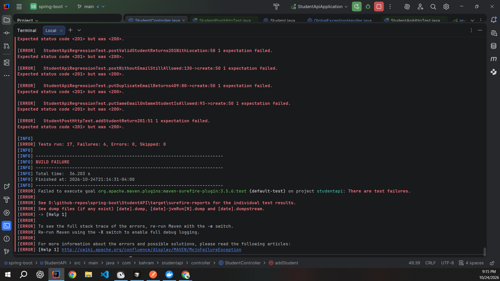
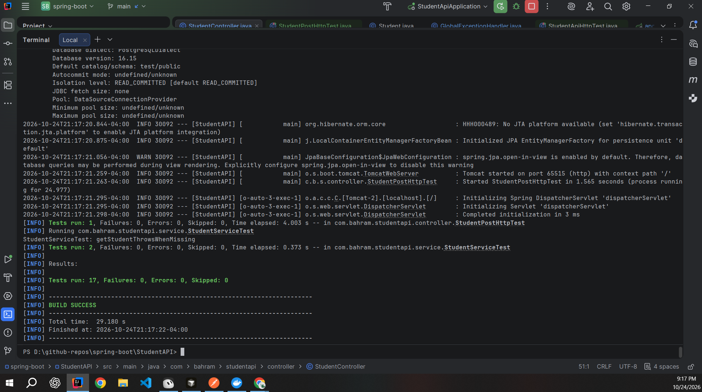

# StudentAPI

[](https://github.com/Bahram-Br/spring-boot/actions/workflows/ci.yml)

StudentAPI is a Spring Boot REST API for practicing backend development and QA testing with Java, PostgreSQL, SQL, Postman, REST Assured, MockMvc, and Testcontainers.

The main local database is PostgreSQL `student_db`, using the `students` table. Every public API path starts with `/api/v1`.

## Current learning workflow

The project is intentionally being used in three layers:

```text
PostgreSQL / SQL
      ↓
StudentAPI
      ↓
Postman manual API testing
      ↓
REST Assured API automation
```

The current goal is to keep manual practice instead of automating everything immediately:

1. Create or inspect student data and practice SQL queries in PostgreSQL.
2. Start StudentAPI and test the endpoints manually with Postman.
3. Write REST Assured tests for the same API behavior.
4. For learning, REST Assured request bodies may initially be edited manually between runs before introducing automatic test-data generation.

Student IDs are generated by PostgreSQL, so create requests do not need to provide an `id`.

## Stack

| Item | Choice |
|---|---|
| Java | 17 |
| Spring Boot | 4.1.0 |
| Web | Spring MVC |
| Persistence | Spring Data JPA + PostgreSQL |
| Schema | Flyway |
| Validation | Jakarta Validation |
| Manual API testing | Postman |
| Web-layer testing | MockMvc + REST Assured MockMvc |
| HTTP integration testing | REST Assured |
| Integration database | Testcontainers PostgreSQL |
| Unit testing | JUnit + Mockito |
| Build | Maven |

## Project layout

```text
StudentAPI
├── pom.xml
├── src/main/java/com/bahram/studentapi
│   ├── StudentApiApplication.java
│   ├── controller/StudentController.java
│   ├── service/StudentService.java
│   ├── repository/StudentRepository.java
│   ├── model/Student.java
│   ├── dto/StudentRequest.java
│   └── exception/
│       ├── StudentNotFoundException.java
│       └── GlobalExceptionHandler.java
├── src/main/resources
│   ├── application.properties
│   ├── application-dev.properties
│   └── db/migration/
│       ├── V1__create_students.sql
│       └── V2__unique_student_email.sql
└── src/test
    ├── java/com/bahram/studentapi
    │   ├── service/StudentServiceTest.java
    │   └── controller/
    │       ├── StudentControllerTest.java
    │       └── StudentApiHttpTest.java
    └── resources/application.properties
```

## Request flow

For the locally running application:

```text
Postman / HTTP Client
        ↓
StudentController
        ↓
StudentService
        ↓
StudentRepository
        ↓
PostgreSQL student_db
```

The controller accepts requests, the service contains business logic, and the repository reads and writes PostgreSQL through Spring Data JPA.

## API endpoints

| Method | Path | Purpose |
|---|---|---|
| POST | `/api/v1/students` | Create a student |
| GET | `/api/v1/students` | Get all students |
| GET | `/api/v1/students/{id}` | Get one student |
| PUT | `/api/v1/students/{id}` | Update a student |
| DELETE | `/api/v1/students/{id}` | Delete a student |
| GET | `/api/v1/students/name/{name}` | Search by name |
| GET | `/api/v1/students/major/{major}` | Search by major |
| GET | `/api/v1/students/email/{email}` | Search by email |
| GET | `/api/v1/students/older-than/{age}` | Find students older than an age |

### Status codes and errors

| Situation | Status |
|---|---|
| Student created | `201 Created` with a `Location` header |
| Invalid request body (blank name, malformed email) | `400 Bad Request` |
| `older-than/{age}` with an age below 15 | `400 Bad Request` |
| Student ID not found | `404 Not Found` |
| Email already used by another student (POST or PUT) | `409 Conflict` |
| Unexpected server error | `500` with a generic message only |

Every error is returned as an RFC 7807 `ProblemDetail` (`application/problem+json`) from `GlobalExceptionHandler`. Validation errors include an `errors` map of field to message. Stack traces are never included in responses; they are only written to the server log.

Example (duplicate email):

```json
{
  "detail": "Email already exists: tom@school.edu",
  "instance": "/api/v1/students",
  "status": 409,
  "title": "Duplicate Email"
}
```

### Known behavior

- Search by name and by major is an exact, case-sensitive match, so `math` does not match `Math`. This is intentional for now and is not treated as a bug.
- Email is optional. When it is provided it must be a well-formed address and unique.

## Database

The local application uses:

```text
Database: student_db
Table: students
User: postgres
Port: 5432
```

The database password is read from the `DB_PASSWORD` environment variable and is not stored in the main application configuration.

Flyway owns the schema:

- `V1__create_students.sql` creates the `students` table.
- `V2__unique_student_email.sql` adds the unique email constraint.
- Hibernate uses `ddl-auto=validate`, so it validates the schema instead of changing it.

The database generates the student ID automatically.

### SQL practice

Example manual data creation:

```sql
INSERT INTO students (age, name, email, gender, major)
VALUES (22, 'Test Student', 'student2@test.com', 'M', 'Web Development');
```

Example queries:

```sql
SELECT * FROM students;

SELECT * FROM students
WHERE id = 2;

SELECT * FROM students
WHERE major = 'Web Development';
```

This manual SQL practice is intentional and is currently part of the learning workflow.

## Postman practice

After starting StudentAPI locally, Postman can call:

```text
http://localhost:8080/api/v1
```

Example:

```http
GET /api/v1/students/2
```

A typical practice cycle is:

```text
Create/check data with SQL
        ↓
Send API request with Postman
        ↓
Inspect status code and JSON response
        ↓
Query PostgreSQL to verify the stored data
```

## Automated tests

The project has three testing levels: unit, web layer, and HTTP integration.

### StudentServiceTest

A unit test using Mockito. The repository is mocked, so this test does not connect to PostgreSQL.

### StudentControllerTest

A web-layer test using `@WebMvcTest`, MockMvc, and REST Assured MockMvc. `StudentService` is mocked.

Current checks include:

- `GET /api/v1/students` returns 200 and an empty array when the mocked service returns no students.
- Missing student ID returns 404.
- A POST request with a blank name returns 400.

This test does not connect to PostgreSQL.

### StudentApiHttpTest

This is the real HTTP integration-test layer.

It uses:

- `@SpringBootTest(webEnvironment = RANDOM_PORT)`
- REST Assured
- Testcontainers
- PostgreSQL 16 Alpine
- `@ServiceConnection`

The current test sends:

```text
GET /api/v1/students
```

and verifies HTTP 200.

The flow is:

```text
REST Assured
      ↓
Real Spring Boot HTTP server
      ↓
Controller → Service → Repository
      ↓
Temporary PostgreSQL Testcontainer
```

Important: this Testcontainers PostgreSQL database is separate from the local `student_db`. Data manually inserted into the local database is therefore not automatically available inside `StudentApiHttpTest`.

The temporary container is useful for isolated automated tests. The local PostgreSQL database remains useful for SQL and Postman practice.

### StudentPostHttpTest

A REST Assured HTTP test that creates a student and verifies the `201 Created` response.

### StudentApiRegressionTest

REST Assured regression tests against a Testcontainers PostgreSQL database, one or more per bug found during exploratory testing. Data is cleared before each test.

- `postValidStudentReturns201WithLocation`
- `postDuplicateEmailReturns409`
- `putDuplicateEmailReturns409`
- `putSameEmailOnSameStudentIsAllowed`
- `olderThanBelowMinimumReturns400WithoutStackTrace`
- `olderThanValidAgeReturns200`
- `postInvalidEmailReturns400WithFieldError`
- `postWithoutEmailStillAllowed`
- `getMissingStudentReturns404ProblemDetail`
- `deleteMissingStudentReturns404ProblemDetail`

## Exploratory testing with an MCP server

The `student-mcp/` folder at the repository root is a TypeScript MCP (Model Context Protocol) server that exposes this API as tools an AI agent can call: list, get, add, update, and delete students, plus search by name, major, email, and age. Non-2xx responses are returned to the agent with their HTTP status and body, so failures are visible instead of hidden. See [`student-mcp/README.md`](student-mcp/README.md) for setup.

I designed the test ideas, ran them through the MCP tools in Cursor, and reviewed each result against the expected status. That session found six defects:

| # | Defect | Before | After | Severity |
|---|---|---|---|---|
| 1 | Error responses leaked the Java stack trace | 500 with stack trace | Generic message, trace only in server log | High |
| 2 | Duplicate email on POST and PUT | 500 | 409 | High |
| 3 | `older-than/{age}` with age below 15 | 500 | 400 | High |
| 4 | Malformed email accepted | 200, saved | 400 | Medium |
| 5 | Successful POST status | 200 | 201 with `Location` | Low |
| 6 | 404 body was plain text | Plain text | JSON `ProblemDetail` | Low |
| 7 | Size of email and name cannot retrieve if it is too long | 500, saved | Low |

Each fix was verified manually in Postman and locked in with a regression test.

### Proving the tests catch the bug

To confirm the regression tests are meaningful, the 201 fix was temporarily reverted (`ResponseEntity.ok` instead of `ResponseEntity.created`). The suite went red with `Expected status code <201> but was <200>`:



After restoring the fix, all 17 tests pass:



## REST Assured learning plan

The current REST Assured work starts simple.

First:

```text
GET request
→ verify status code
```

Then:

```text
POST student
→ verify response
→ GET student
→ verify returned data
```

At the current learning stage, request data can be changed manually between exercises. Automatic/random test-data generation can be added later after the manual SQL, Postman, and REST Assured workflow is understood.

## Running the application

PostgreSQL 18 is installed locally and the application expects `student_db`.

In PowerShell:

```powershell
$env:DB_PASSWORD = "your-database-password"
$env:SPRING_PROFILES_ACTIVE = "dev"

cd D:\github-repos\spring-boot\StudentAPI
mvn spring-boot:run
```

After `Started StudentApiApplication`, the API is available at:

```text
http://localhost:8080
```

With the `dev` profile active, Hibernate SQL is printed in the application logs.

## Running tests

```powershell
mvn test
```

`StudentServiceTest` and `StudentControllerTest` do not use the local PostgreSQL database.

`StudentApiHttpTest`, `StudentPostHttpTest`, and `StudentApiRegressionTest` use a temporary PostgreSQL Testcontainer, so Docker must be running for them.

### Continuous integration

GitHub Actions (`.github/workflows/ci.yml`) runs on every push and pull request to `main`:

- `api-tests`: sets up Java 17 and runs `./mvnw -B test` in `StudentAPI`. The GitHub Ubuntu runner has Docker, so the Testcontainers PostgreSQL tests run there too. The Surefire reports are uploaded as a `surefire-reports` artifact, even when tests fail.
- `mcp-server`: sets up Node 20, then runs `npm ci`, `npm run build`, and `npm test` in `student-mcp`.

The badge at the top of this README shows the result of the latest run on `main`.

## Current direction

The project is being developed as an API QA portfolio project rather than only a CRUD application.

The intended progression is:

```text
SQL practice
→ Postman manual testing
→ REST Assured automation
→ response validation
→ database validation
→ negative/boundary testing
→ CI and test reporting
```

The priority is understanding and testing each layer before adding more automation or framework complexity.
