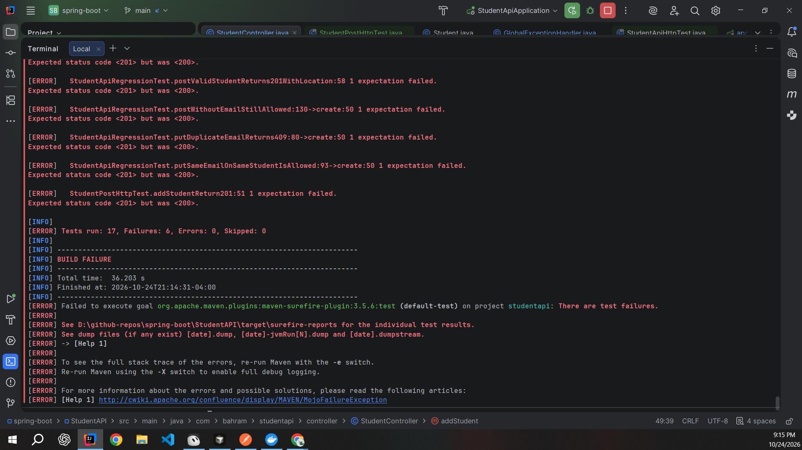
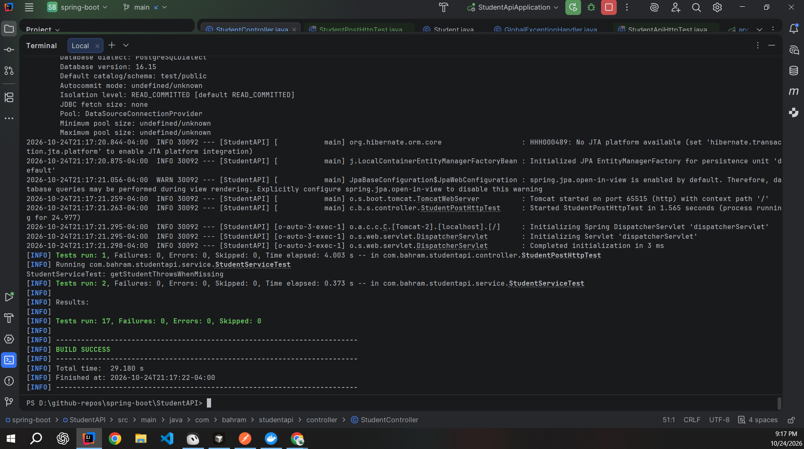

# StudentAPI

[](https://github.com/Bahram-Br/spring-boot/actions/workflows/ci.yml)

StudentAPI is a Spring Boot REST API backed by PostgreSQL that I built as an API QA and test automation portfolio project. It has **43 automated tests** across four layers (unit, web layer, HTTP integration with REST Assured and Testcontainers, and Selenium UI). Exploratory testing found **8 real defects**; each one was fixed and locked in with a regression test, and every push runs in GitHub Actions.

## Highlights

- **Layered test strategy:** Mockito unit tests, `@WebMvcTest` web-layer tests, REST Assured HTTP tests against a real server and a throwaway PostgreSQL container, and Selenium UI tests in headless Chrome.
- **Bugs found and fixed:** 8 defects (stack-trace leak, 500s that should be 409/400, case-sensitive duplicate emails, and more), each with a before/after record and a regression test.
- **Proof the tests work:** I reverted a fix on purpose to show the suite goes red, then green again (screenshots below).
- **Clear error contract:** every error is an RFC 7807 `ProblemDetail`, with no stack traces in responses.
- **Selenium with Page Object:** stable `data-testid` locators and explicit waits, and tests that check UI to API and API to UI.
- **CI:** GitHub Actions runs the Java tests (including Testcontainers and Selenium) and the TypeScript MCP server build and tests.
- **Exploratory testing through an MCP server:** a small TypeScript MCP server exposes the API as tools for exploratory sessions.

## Stack

| Item | Choice |
|---|---|
| Java | 17 |
| Spring Boot | 4.1.0 |
| Web | Spring MVC |
| Persistence | Spring Data JPA + PostgreSQL |
| Schema | Flyway |
| Validation | Jakarta Validation |
| Unit testing | JUnit 5 + Mockito |
| Web-layer testing | MockMvc + REST Assured MockMvc |
| HTTP integration testing | REST Assured |
| Integration database | Testcontainers PostgreSQL 16 |
| UI testing | Selenium 4 (Page Object, headless Chrome) |
| CI | GitHub Actions |
| Optional AI layer | Spring AI 2.0 (off by default) |
| MCP server | TypeScript + MCP SDK, tested with Vitest |
| Manual API testing | Postman |
| Build | Maven |

## Project layout

```text
StudentAPI
├── pom.xml
├── src/main/java/com/bahram/studentapi
│   ├── StudentApiApplication.java
│   ├── controller/StudentController.java
│   ├── service/StudentService.java
│   ├── repository/StudentRepository.java
│   ├── model/Student.java
│   ├── dto/StudentRequest.java
│   ├── ai/                         (optional, off by default)
│   │   ├── AiController.java
│   │   └── StudentTools.java
│   └── exception/
│       ├── StudentNotFoundException.java
│       ├── DuplicateEmailException.java
│       └── GlobalExceptionHandler.java
├── src/main/resources
│   ├── application.properties
│   ├── application-dev.properties
│   ├── static/                     (Selenium test page)
│   │   ├── index.html
│   │   ├── app.js
│   │   └── style.css
│   └── db/migration/
│       ├── V1__create_students.sql
│       ├── V2__unique_student_email.sql
│       └── V3__unique_student_email_lower.sql
└── src/test
    ├── java/com/bahram/studentapi
    │   ├── service/StudentServiceTest.java
    │   ├── controller/
    │   │   ├── StudentControllerTest.java
    │   │   ├── StudentApiHttpTest.java
    │   │   ├── StudentPostHttpTest.java
    │   │   ├── StudentApiRegressionTest.java
    │   │   └── StudentApiEdgeCaseTest.java
    │   └── ui/
    │       ├── StudentUiTest.java
    │       └── pages/StudentPage.java
    └── resources/application.properties
```

## Request flow

For the locally running application:

```text
Postman / HTTP Client
        ↓
StudentController
        ↓
StudentService
        ↓
StudentRepository
        ↓
PostgreSQL student_db
```

The controller accepts requests, the service contains business logic, and the repository reads and writes PostgreSQL through Spring Data JPA.

## API endpoints

| Method | Path | Purpose |
|---|---|---|
| POST | `/api/v1/students` | Create a student |
| GET | `/api/v1/students` | Get all students |
| GET | `/api/v1/students/{id}` | Get one student |
| PUT | `/api/v1/students/{id}` | Update a student |
| DELETE | `/api/v1/students/{id}` | Delete a student |
| GET | `/api/v1/students/name/{name}` | Search by name |
| GET | `/api/v1/students/major/{major}` | Search by major |
| GET | `/api/v1/students/email/{email}` | Search by email |
| GET | `/api/v1/students/older-than/{age}` | Find students older than an age |

### Status codes and errors

| Situation | Status |
|---|---|
| Student created | `201 Created` with a `Location` header |
| Invalid request body (blank name, malformed email) | `400 Bad Request` |
| `older-than/{age}` with an age below 15 | `400 Bad Request` |
| Student ID not found | `404 Not Found` |
| Email already used by another student (POST or PUT) | `409 Conflict` |
| Unexpected server error | `500` with a generic message only |

Every error is returned as an RFC 7807 `ProblemDetail` (`application/problem+json`) from `GlobalExceptionHandler`. Validation errors include an `errors` map of field to message. Stack traces are never included in responses; they are only written to the server log.

Example (duplicate email):

```json
{
  "detail": "Email already exists: tom@school.edu",
  "instance": "/api/v1/students",
  "status": 409,
  "title": "Duplicate Email"
}
```

### Known behavior

- Search by name and by major is an exact, case-sensitive match, so `math` does not match `Math`. This is intentional for now and is not treated as a bug.
- Email is optional. When it is provided it must be a well-formed address and unique. Uniqueness is case-insensitive: emails are trimmed and stored in lowercase, and search by email ignores case.

## Database

The local application uses:

```text
Database: student_db
Table: students
User: postgres
Port: 5432
```

The database password is read from the `DB_PASSWORD` environment variable and is not stored in the main application configuration.

Flyway owns the schema:

- `V1__create_students.sql` creates the `students` table.
- `V2__unique_student_email.sql` adds the unique email constraint.
- `V3__unique_student_email_lower.sql` adds a unique index on `lower(email)`, so emails that differ only in case are rejected by the database too.
- Hibernate uses `ddl-auto=validate`, so it validates the schema instead of changing it.

The database generates the student ID automatically.

## Automated tests

The project has four testing levels: unit, web layer, HTTP integration, and UI (Selenium).

| Test class | Layer | Tests |
|---|---|---|
| `StudentApiEdgeCaseTest` | HTTP integration (boundary and negative) | 16 |
| `StudentApiRegressionTest` | HTTP integration (one or more per bug) | 14 |
| `StudentUiTest` | Selenium UI | 6 |
| `StudentControllerTest` | Web layer | 3 |
| `StudentServiceTest` | Unit | 2 |
| `StudentApiHttpTest` | HTTP integration | 1 |
| `StudentPostHttpTest` | HTTP integration | 1 |
| **Total** | | **43** |

### StudentServiceTest

A unit test using Mockito. The repository is mocked, so this test does not connect to PostgreSQL.

### StudentControllerTest

A web-layer test using `@WebMvcTest`, MockMvc, and REST Assured MockMvc. `StudentService` is mocked.

Current checks include:

- `GET /api/v1/students` returns 200 and an empty array when the mocked service returns no students.
- Missing student ID returns 404.
- A POST request with a blank name returns 400.

This test does not connect to PostgreSQL.

### StudentApiHttpTest

This is the real HTTP integration-test layer.

It uses:

- `@SpringBootTest(webEnvironment = RANDOM_PORT)`
- REST Assured
- Testcontainers
- PostgreSQL 16 Alpine
- `@ServiceConnection`

The current test sends:

```text
GET /api/v1/students
```

and verifies HTTP 200.

The flow is:

```text
REST Assured
      ↓
Real Spring Boot HTTP server
      ↓
Controller → Service → Repository
      ↓
Temporary PostgreSQL Testcontainer
```

Important: this Testcontainers PostgreSQL database is separate from the local `student_db`. Data manually inserted into the local database is therefore not automatically available inside `StudentApiHttpTest`.

The temporary container is useful for isolated automated tests. The local PostgreSQL database remains useful for SQL and Postman practice.

### StudentPostHttpTest

A REST Assured HTTP test that creates a student and verifies the `201 Created` response.

### StudentApiEdgeCaseTest

REST Assured boundary and negative tests against the Testcontainers PostgreSQL database. Each negative test changes only one field, so a failure points to one rule.

- **Age:** `1` is accepted; `0`, `-1`, missing, and a string value return 400 with an `age` field error.
- **Name:** blank, whitespace-only, and `null` return 400; exactly 255 characters (the column limit) is accepted, and 256 returns 400 instead of a database error.
- **Request format:** malformed JSON and a non-numeric ID return 400 as a `ProblemDetail`.
- **Missing data:** `PUT` on a missing student and `GET` after `DELETE` return 404.
- **Searches:** a search with no match returns an empty list, and `older-than/{age}` is strictly greater than the given age.

### StudentApiRegressionTest

REST Assured regression tests against a Testcontainers PostgreSQL database, one or more per bug found during exploratory testing. Data is cleared before each test.

- `postValidStudentReturns201WithLocation`
- `postDuplicateEmailReturns409`
- `putDuplicateEmailReturns409`
- `putSameEmailOnSameStudentIsAllowed`
- `olderThanBelowMinimumReturns400WithoutStackTrace`
- `olderThanValidAgeReturns200`
- `postInvalidEmailReturns400WithFieldError`
- `postWithoutEmailStillAllowed`
- `getMissingStudentReturns404ProblemDetail`
- `deleteMissingStudentReturns404ProblemDetail`
- `postDuplicateEmailDifferentCaseReturns409`
- `postEmailIsStoredLowercase`
- `putDuplicateEmailDifferentCaseReturns409`
- `searchByEmailIsCaseInsensitive`

## UI tests with Selenium

`src/main/resources/static/index.html` (with `app.js` and `style.css`) is a small plain HTML page served at `http://localhost:8080/index.html`. It has a form to add a student, a table that lists students with `fetch GET /api/v1/students` (refreshed after each add), and an error area that shows the API's ProblemDetail error, for example `400: Request body is invalid. (name must not be blank)` or `409: Email already exists: tom@school.edu`. Every element the tests use has a stable `data-testid`.

- **Page Object pattern:** `ui/pages/StudentPage.java` holds all locators and actions (`open`, `addStudent`, `rows`, `errorMessage`). Tests only call these methods, so a page change is fixed in one place. It uses `WebDriverWait` explicit waits, never `Thread.sleep`.
- **`StudentUiTest`:** `@SpringBootTest(RANDOM_PORT)` with the same PostgreSQL Testcontainer as the HTTP tests, headless Chrome (`--headless=new`), and `deleteAll()` before each test. Checks:
  - the page loads with an empty table;
  - **UI to API:** a student added through the form appears in the table, and a REST Assured `GET` confirms it was saved;
  - **API to UI:** a student created with REST Assured `POST` is shown in the table;
  - a duplicate email in different case shows the 409 error;
  - a blank name shows the 400 error;
  - an invalid email shows the 400 error;
- **Running:** they run with the other tests (`.\mvnw.cmd test` on Windows, `./mvnw test` on macOS/Linux). Chrome and Docker must be installed; Selenium Manager downloads the matching ChromeDriver automatically. Run only the UI tests with `.\mvnw.cmd test -Dtest=StudentUiTest`.

## Exploratory testing with an MCP server

The `student-mcp/` folder at the repository root is a TypeScript MCP (Model Context Protocol) server that exposes this API as tools an AI agent can call: list, get, add, update, and delete students, plus search by name, major, email, and age. Non-2xx responses are returned to the agent with their HTTP status and body, so failures are visible instead of hidden. See [`student-mcp/README.md`](student-mcp/README.md) for setup.

I designed the test ideas, ran them through the MCP tools in Cursor, and reviewed each result against the expected status. That session, plus the later edge-case tests, found eight defects:

| # | Defect | Before | After | Severity |
|---|---|---|---|---|
| 1 | Error responses leaked the Java stack trace | 500 with stack trace | Generic message, trace only in server log | High |
| 2 | Duplicate email on POST and PUT | 500 | 409 | High |
| 3 | `older-than/{age}` with age below 15 | 500 | 400 | High |
| 4 | Malformed email accepted | 200, saved | 400 | Medium |
| 5 | Successful POST status | 200 | 201 with `Location` | Low |
| 6 | 404 body was plain text | Plain text | JSON `ProblemDetail` | Low |
| 7 | Long names return misleading error 409 | 409, "Email already exists" | 400 with field error| Medium |
| 8 | Duplicate email check was case-sensitive (`TOM@school.edu` accepted next to `tom@school.edu`) | 201, saved | 409 | Medium |

Each fix was verified manually in Postman and locked in with a regression test.

### Proving the tests catch the bug

To confirm the regression tests are meaningful, the 201 fix was temporarily reverted (`ResponseEntity.ok` instead of `ResponseEntity.created`). The suite went red with `Expected status code <201> but was <200>`:



After restoring the fix, the tests pass again:



## Optional AI module

The `ai/` package uses Spring AI to put a chat layer on top of the API:

- `GET /api/v1/ai/chat?message=...` sends a prompt to the model.
- `GET /api/v1/ai/agent?message=...` lets the model call `StudentTools` (list students, find by major, add, and delete) through Spring AI `@Tool` methods.

The module is **off by default**. `AiController` and `StudentTools` are only created when `app.ai.enabled=true` (`@ConditionalOnProperty`), so the API, the tests, and CI run without any AI key.

To turn it on locally, add these environment variables to the run configuration:

```powershell
$env:AI_ENABLED = "true"
$env:OPENAI_API_KEY = "your-api-key"
```

The test configuration sets a dummy `spring.ai.openai.api-key=test`, because the Spring AI OpenAI starter still needs a key to start even when the AI endpoints are disabled. No real model is called during tests.

## Running the application

PostgreSQL 18 is installed locally and the application expects `student_db`.

In PowerShell:

```powershell
$env:DB_PASSWORD = "your-database-password"
$env:SPRING_PROFILES_ACTIVE = "dev"

cd D:\github-repos\spring-boot\StudentAPI
.\mvnw.cmd spring-boot:run
```

After `Started StudentApiApplication`, the API is available at:

```text
http://localhost:8080
```

With the `dev` profile active, Hibernate SQL is printed in the application logs.

## Running tests

```powershell
cd D:\github-repos\spring-boot\StudentAPI
.\mvnw.cmd test        # Windows
./mvnw test            # macOS / Linux
```

`StudentServiceTest` and `StudentControllerTest` do not use the local PostgreSQL database.

`StudentApiHttpTest`, `StudentPostHttpTest`, `StudentApiRegressionTest`, `StudentApiEdgeCaseTest`, and `StudentUiTest` use a temporary PostgreSQL Testcontainer, so Docker must be running for them. `StudentUiTest` also needs Google Chrome (it runs headless).

### Continuous integration

GitHub Actions (`.github/workflows/ci.yml`) runs on every push and pull request to `main`:

- `api-tests`: sets up Java 17 and runs `./mvnw -B test` in `StudentAPI`. The GitHub Ubuntu runner has Docker, so the Testcontainers PostgreSQL tests run there too, and Chrome is preinstalled for the Selenium UI tests. The Surefire reports are uploaded as a `surefire-reports` artifact, even when tests fail.
- `mcp-server`: sets up Node 20, then runs `npm ci`, `npm run build`, and `npm test` in `student-mcp`.

The badge at the top of this README shows the result of the latest run on `main`.

## Manual testing

Before automating a behavior, I check it by hand: create or inspect data with SQL in the local `student_db`, call the endpoint in Postman at `http://localhost:8080/api/v1`, check the status code and JSON, then query PostgreSQL to confirm what was stored. Every bug fix in the table above was verified this way before its regression test was written.

## Next steps

- Add a test coverage report (JaCoCo) and an HTML test report to CI.
- Add a `lastName` field, with the email generated from the first initial and last name.
